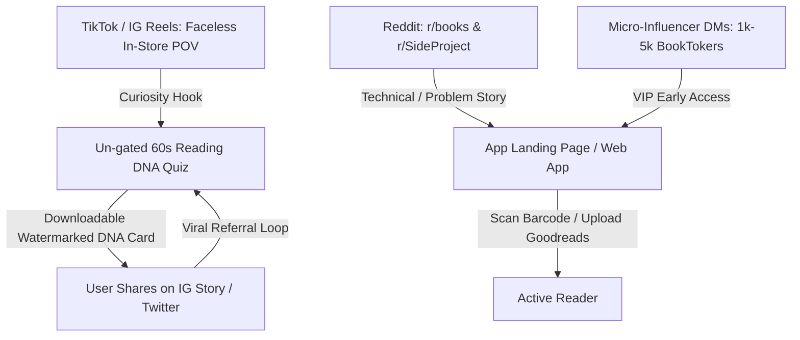

# GoodBetterBestReads: Growth, Distribution & Capacity Blueprint
> **Executive Strategy Document**  
> *Author:* Senior Architecture & Product Advisory  
> *Date:* October 2026  
> *Status:* Reference & Planning  

---

## 1. Executive Summary & Brutal Product Realities

### The Honest Truth About the App
Building a Goodreads competitor is notoriously difficult. Thousands of developers have tried building "Goodreads but with a modern UI," and almost all of them die quietly because users' reading streaks, friend networks, and shelf history on Goodreads represent high switching friction.

However, **GoodBetterBestReads has two distinct, defensible advantages** that standard book cataloging apps lack:
1. **The In-Store Physical Barcode Scanner & Series Alert**: Standing in a bookstore, scanning a physical book's barcode, and getting an immediate AI verdict (*"90% alignment with your taste, BUT it's Book 2 in a series—start with Book 1"*) solves an acute, physical shopping dilemma that neither Goodreads nor StoryGraph addresses.
2. **The Reading DNA Visual Identity**: Readers—especially romance, fantasy, and sci-fi fans—love identifying with tropes, pacing styles, and literary archetypes. It functions as a personal trophy similar to *Spotify Wrapped*.

### The Weak Spots to Acknowledge
* **The "Shelf Tracker" Trap**: If you market this as a place to log books, you will lose. The market is saturated. You must market it as an **in-store shopping concierge and taste diagnostic**.
* **Open Library Latency**: External book lookups on Open Library can take 2–4 seconds for obscure editions. In a physical aisle, delays degrade the "magic" feeling. A local caching/pre-warming layer is essential as traffic grows.
* **Cold-Start Friction**: Asking a stranger to sign up and upload a Goodreads CSV before they experience any value creates a high bounce rate. The top of the funnel must be zero-friction.

---

## 2. Anonymous Growth Strategy (0 to 1,000 Users)

*Goal: Drive qualified book enthusiasts to the platform without leveraging personal social accounts, friends, or family.*



### Strategy A: The "Show, Don't Pitch" Reddit Playbook
Redditors aggressively downvote direct promotion, but they love open-source, indie-hacker problem-solving stories.

* **Target Subreddits**:
  * `r/books` (23M+ readers)
  * `r/fantasy` (3M+ readers)
  * `r/romancebooks` (heavy trope consumers, very vocal about reading tools)
  * `r/SideProject` (builders who give constructive technical and UX feedback)
  * `r/webdev` or `r/nextjs` (showcase the PWA + barcode scanner architecture)
* **The Post Structure (Example)**:
  * **Title**: *"I kept accidentally buying sequels in bookstores, so I built an AI barcode scanner that checks my reading history before I buy."*
  * **Media**: A 15-second screen recording showing a barcode scan, followed by the yellow warning badge: *Proceed with Caution: Book 2 in series*.
  * **Body**: Keep it humble and problem-focused.
    > *"I got tired of clunky Goodreads in physical bookstores. My wife and I wanted something that scans physical ISBN barcodes, matches our taste profile, and warns us if we're picking up a sequel or a trope we dislike. It's totally free, no ads, built with Next.js and Supabase. Would love feedback from fellow readers."*

---

### Strategy B: Faceless POV Content on BookTok & Reels
BookTok is the highest-converting organic channel for literature, driven almost entirely by POV videos, aesthetic b-roll, and reader relatable humor. You do **not** need to show your face.

* **The Setup**:
  * Hold a smartphone in one hand, filming a physical book on a bookstore table or shelf with the other.
* **Content Hook 1 (The Warning)**:
  * *Text on screen*: *"POV: You almost bought this book until your scanner saved you \$18."*
  * *Action*: Camera points at book cover $\rightarrow$ flips to barcode $\rightarrow$ scanner bleeps $\rightarrow$ UI pops up: *"88% Match, but you gave Book 1 3 stars. Recommendation: Borrow, don't buy."*
* **Content Hook 2 (The Taste Diagnostic)**:
  * *Text on screen*: *"Told my AI librarian my 3 favorite books and it read me for filth."*
  * *Action*: Show the Reading DNA breakdown: *"Enemies-to-lovers addict with zero patience for slow-burn worldbuilding."*
* **Cadence**: 2–3 short videos per week on a dedicated `@goodbetterbestreads` account.

---

### Strategy C: The Un-Gated 60-Second Reading DNA Quiz
Stranger conversion rates drop by 80% if registration is required before value delivery.

* **The Concept**: Create a public URL (`/quiz` or `/taste-test`).
* **The Flow**:
  1. User selects 3 books they loved and 1 book they hated.
  2. Selects 3 sliders (Fast-paced vs. Atmospheric, Plot-driven vs. Character-driven, Cozy vs. Dark).
  3. The app generates an aesthetic, downloadable **Reading DNA Card** (PNG) with your logo and URL: `goodbetterbestreads.com`.
  4. Prompt at the bottom: *"Want this AI to check your books while shopping? Create a free account."*
* **The Growth Loop**: Readers share their DNA card on Instagram Stories and Twitter to compare with friends, driving zero-cost organic referral traffic.

---

### Strategy D: Micro-Influencer Outreach (1k–5k Followers)
Avoid macro-influencers who charge commercial agency rates. Micro-reviewers are passionate, engaged, and love discovering tools first.

* **Outreach Template (Instagram / TikTok DM)**:
  > *"Hey [Name]! Loved your recent review on [Recent Book They Posted]. My wife and I got frustrated with how outdated Goodreads is for in-store shopping, so I spent the last few months building a private scanner that checks physical books against your personal taste and flags if it's an unread sequel. It's totally free with zero ads. Would love to send you a private invite if you want to test it on your next bookstore run!"*

---

## 3. Infrastructure Capacity & Scalability Blueprint

Here is how the current architecture performs under scale, where each bottleneck occurs, and how to address it.

```
┌───────────────────────────────────────────────────────────────────────────────┐
│                           INFRASTRUCTURE CAPACITY SCALE                       │
├─────────────────────┬──────────────┬───────────────────┬──────────────────────┤
│ Active User Count   │ Monthly Cost │ Limiting Factor   │ Action Required      │
├─────────────────────┼──────────────┼───────────────────┼──────────────────────┤
│ 0 - 100 Users       │ $0.00        │ None              │ Current free stack   │
│ 100 - 500 Users     │ ~$2 - $5     │ Gemini Rate Limit │ Add GCP API Billing  │
│ 500 - 2,500 Users   │ $25.00       │ Supabase 500MB DB │ Upgrade Supabase Pro │
│ 2,500 - 10,000 Users│ $50 - $70    │ Serverless/OL API │ Redis Cache & Pooler │
└─────────────────────┴──────────────┴───────────────────┴──────────────────────┘
```

---

### Tier 1: 0 to 100 Active Users (The Zero-Cost Sandbox)
* **Monthly Cost**: **\$0.00**
* **Database (Supabase Free)**:
  * 100 users × ~200 books = ~20,000 rows in `user_books`.
  * Total database disk usage: **~15MB** (well under the 500MB limit).
* **AI (Google Gemini 2.5 Flash Free Tier)**:
  * 15 Requests Per Minute (RPM), 1,500 Requests Per Day (RPD).
  * With 100 users scanning occasionally, concurrent requests rarely exceed 2–3 per minute.
* **Hosting (Vercel Hobby)**:
  * Invocations and edge bandwidth well within free limits.

---

### Tier 2: 100 to 500 Active Users (The Gemini Concurrency Bottleneck)
* **Monthly Cost**: **~\$2.00 to \$5.00**
* **The Failure Point**: **Gemini 15 RPM Rate Limit**.
  * During peak hours (Saturday afternoon bookstore trips), 16 concurrent users scanning books or clicking "Ask Librarian" will trigger `HTTP 429: Too Many Requests` for user #16.
* **The Solution**:
  * Link a credit card to Google Cloud Project for pay-as-you-go billing.
  * Gemini 2.5 Flash costs **\$0.075 per 1M input tokens** and **\$0.30 per 1M output tokens**.
  * Even with 500 active users making 2,000 taste evaluations a month, your total AI bill will be under **\$3.00/month**.
  * Rate limits jump from 15 RPM to **1,000+ RPM**.

---

### Tier 3: 500 to 2,500 Active Users (The Storage & Timeout Ceiling)
* **Monthly Cost**: **~\$25.00 to \$35.00**
* **The Failure Point 1: Supabase Free Tier 500MB Limit**.
  * 2,000 users importing Goodreads CSVs (avg. 300 books) = **600,000 rows** in `user_books` + catalog metadata + `pgvector` taste embeddings.
  * Vector embeddings (768 dimensions) take ~3KB–5KB per row plus indexes. The database will surpass 500MB.
  * **Solution**: Upgrade to **Supabase Pro (\$25/month)**. Provides 8GB disk space, daily backups, dedicated resources, and no auto-pausing.
* **The Failure Point 2: Open Library Timeouts**.
  * Heavy search traffic hitting Open Library will encounter rate limiting or 5+ second latency.
  * Vercel serverless lambdas timeout after **10 seconds** on free tiers, resulting in `504 Gateway Timeout`.
  * **Solution**: Enable an internal catalog cache. If *Project Hail Mary* has already been resolved by one user, serve it directly from PostgreSQL/Supabase instead of hitting Open Library again.

---

### Tier 4: 2,500 to 10,000+ Active Users (Production Scale)
* **Monthly Cost**: **~\$65.00 to \$90.00**
* **The Failure Point 1: Vercel Commercial Terms**.
  * Vercel requires **Vercel Pro (\$20/month)** for apps with substantial traffic or commercial intent.
* **The Failure Point 2: Database Connection Saturation**.
  * 50+ concurrent Next.js serverless functions opening direct connections to PostgreSQL will throw: `FATAL: remaining connection slots are reserved for non-replication superuser connections`.
  * **Solution**: Ensure all server-side Supabase queries connect via **Supavisor Transaction Connection Pooling** (port `6543`), which safely multiplexes thousands of lambdas over a small pool of direct database connections.
* **The Failure Point 3: Search Latency**.
  * Implement an Upstash Redis or memory cache for popular book searches to deliver sub-50ms search results globally.

---

## 4. Execution Roadmap & Next Steps

### Phase A: Pre-Launch Technical Hardening (Current Sprint)
- [x] Barcode camera scanner with EAN-13 / EAN-5 ISBN parsing.
- [x] In-Store Librarian Taste Analysis with Series Order Detection.
- [x] Library recognition and Step 2 typography overhaul.
- [ ] Ensure Google Cloud Project billing is linked to Gemini API key to remove the 15 RPM ceiling.
- [ ] Pre-populate search queries from local `books` catalog before querying external APIs.

### Phase B: Zero-Friction Top of Funnel
- [ ] Build standalone, un-gated `/quiz` page generating downloadable Reading DNA cards.
- [ ] Add watermark URL (`goodbetterbestreads.com`) to generated DNA graphics.

### Phase C: Anonymous Marketing Execution
- [ ] Record 3 short bookstore POV clips showing the barcode scanner and series alert.
- [ ] Post technical breakdown on `r/SideProject` and problem-focused story on `r/books`.
- [ ] Direct message 5 micro-reviewers on BookTok/Bookstagram offering free beta access.
