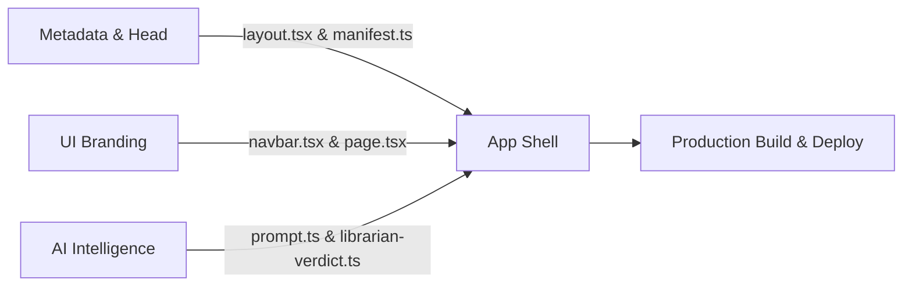

# TBRScout Rebranding & Migration Playbook
> **Step-by-Step Transition Guide: GoodBetterBestReads $\rightarrow$ TBRScout**  
> *Target Domain:* `tbrscout.com`  
> *Target Tagline:* *"Scout your next read before you buy."*  
> *Status:* Ready for Execution  

---

## 1. Brand Identity Overview

| Element | Current | New (TBRScout) |
| :--- | :--- | :--- |
| **App Name** | GoodBetterBestReads | **TBRScout** |
| **Short / PWA Name** | GBBReads | **TBRScout** |
| **Production Domain** | `goodbetterbestreads.vercel.app` | **`tbrscout.com`** |
| **Primary Tagline** | *A smarter, modern alternative to Goodreads.* | **`Scout your next read before you buy.`** |
| **Secondary Tagline** | *Track your shelves, discover your Reading DNA.* | **`Your in-store reading concierge & TBR curator.`** |
| **Brand Position** | Shelf tracking & cataloging app | **Physical bookstore scout & taste intelligence** |

---

## 2. Phase 1: Domain & DNS Setup (5–10 Minutes)

### Step 1: Purchase `tbrscout.com`
* **Option A (Fastest — 1 Click in Vercel)**:
  1. Go to [Vercel Dashboard](https://vercel.com) $\rightarrow$ select `good-better-best-reads` project.
  2. Navigate to **Settings** $\rightarrow$ **Domains**.
  3. Enter `tbrscout.com` and select **Buy** (~$15/year). Vercel auto-configures DNS and SSL.
* **Option B (Registrar — Namecheap / Cloudflare / Porkbun)**:
  1. Purchase `tbrscout.com` on your preferred registrar (~$10/year).
  2. Add the domain in Vercel **Settings** $\rightarrow$ **Domains**.
  3. Set up the two DNS records provided by Vercel:
     * **A Record**: Host `@` $\rightarrow$ `76.76.21.21`
     * **CNAME Record**: Host `www` $\rightarrow$ `cname.vercel-dns.com`

---

## 3. Phase 2: Supabase Auth & Security Configuration (3 Minutes)

*(Critical: Required so Google OAuth and magic login links redirect to `tbrscout.com`)*

1. Log into your [Supabase Dashboard](https://supabase.com/dashboard) and open the project.
2. Navigate to **Authentication** $\rightarrow$ **URL Configuration**.
3. Update the **Site URL**:
   ```text
   https://tbrscout.com
   ```
4. In **Redirect URLs**, add the following whitelisted entries:
   ```text
   https://tbrscout.com/**
   https://www.tbrscout.com/**
   http://localhost:3000/**
   ```
5. *(If Google OAuth is enabled in Google Cloud Console)*:
   * Update the Authorized redirect URI to:  
     `https://<your-supabase-ref>.supabase.co/auth/v1/callback` (already set) and add `https://tbrscout.com` to Authorized Javascript Origins.
6. Click **Save**.

---

## 4. Phase 3: Codebase Updates Checklist (10–15 Minutes)

Every change is purely presentational and config-based. **Zero database migrations or schema alterations required.**



### 1. App Shell & HTML Metadata
* [ ] **`app/layout.tsx`**:
  * Update default title: `"TBRScout — Scout Your Next Read Before You Buy"`
  * Update description: `"Your in-store reading concierge. Scan barcodes, match your taste DNA, and check series order before buying."`
  * Update Open Graph and Twitter metadata to use `https://tbrscout.com`.
* [ ] **`app/manifest.ts` (Mobile PWA)**:
  * `name`: `"TBRScout"`
  * `short_name`: `"TBRScout"`
  * `description`: `"Scan barcodes, discover reading DNA, and scout books for your TBR stack."`

### 2. Navigation & Landing Page UI
* [ ] **`components/layout/navbar.tsx`**:
  * Change brand text from `GoodBetterBestReads` to `TBRScout`.
* [ ] **`app/page.tsx` (Hero Section)**:
  * Update headline: *"Meet TBRScout: Your In-Store Reading Concierge"*.
  * Update subheadline to focus on the barcode scanner, librarian verdict, and Reading DNA.

### 3. AI Prompts & System Identity
* [ ] **`services/librarian/prompt.ts`**:
  * Update system role:  
    `"You are the TBRScout Personal Librarian, a sharp, empathetic, and discerning literary concierge..."`
* [ ] **`lib/librarian-verdict.ts`**:
  * Update prompt context:  
    `"You are the in-store librarian for TBRScout. Your job is to give readers a fast, honest verdict before they purchase a physical book..."`

### 4. Sharing, Exports & Watermarks
* [ ] **`lib/share.ts`**:
  * Update share copy: `"Check out my TBR stack and library on TBRScout!"`
  * Set origin fallback to `https://tbrscout.com`.
* [ ] **`app/api/og/reading-dna/route.tsx`**:
  * Update card footer watermark from `goodbetterbestreads.vercel.app` to `tbrscout.com`.
* [ ] **`components/library/export-modal.tsx`**:
  * Default exported file names: `tbrscout-library.csv` and `tbrscout-library.json`.

### 5. Service Worker & Config
* [ ] **`public/sw.js`**:
  * Update cache name: `CACHE_NAME = "tbrscout-pwa-v1"`.
* [ ] **`package.json`**:
  * Update `"name": "tbrscout"`.

---

## 5. Phase 4: GitHub & Vercel Maintenance (Optional — 2 Minutes)

1. **GitHub Repository**:
   * In GitHub $\rightarrow$ **Settings** $\rightarrow$ **Repository name**, change `good-better-best-reads` $\rightarrow$ `tbr-scout`.
   * Update your local git remote:
     ```bash
     git remote set-url origin https://github.com/rabrodbeck/tbr-scout.git
     ```
   *(Note: GitHub automatically redirects the old URL, so nothing breaks if skipped).*

2. **Vercel Project Settings**:
   * Under **Settings** $\rightarrow$ **Environment Variables**, set:
     * `NEXT_PUBLIC_APP_URL` = `https://tbrscout.com`
     * `NEXT_PUBLIC_SITE_URL` = `https://tbrscout.com`

---

## 6. Phase 5: Verification & Launch Checklist

Once the code is deployed and the domain resolves:

- [ ] **Home Page & Navigation**: Verify title shows "TBRScout" in the browser tab and navbar.
- [ ] **Barcode Scanner & Verdict**: Scan a book; verify the verdict card displays cleanly with no old brand references.
- [ ] **Supabase Authentication**: Log out and log back in; verify redirect lands on `tbrscout.com/library`.
- [ ] **PWA Home Screen Install**: Test "Add to Home Screen" on iOS/Android; verify the icon label reads **TBRScout**.
- [ ] **Social Share / OG Preview**: Share a Reading DNA link; verify the card shows `tbrscout.com` in the preview thumbnail.
- [ ] **CSV Export**: Click "Export Library" and verify the downloaded file is `tbrscout-library.csv`.
