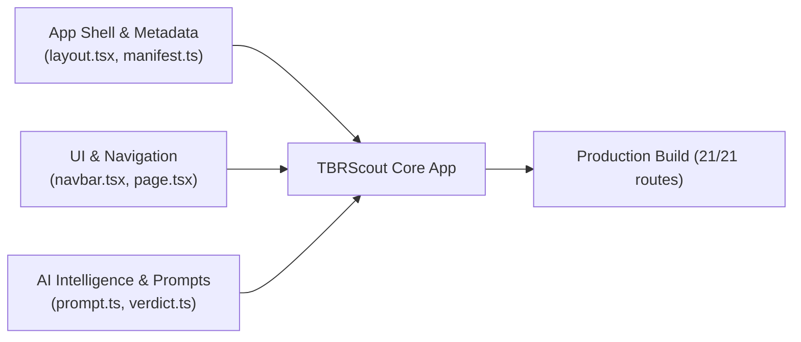

# TBRScout Rebranding & Migration Playbook
> **Step-by-Step Transition Guide: GoodBetterBestReads $\rightarrow$ TBRScout**  
> *Target Domain:* `https://tbrscout.vercel.app` (custom `.com` reserved for later)  
> *Target Tagline:* *"Scout your next read before you buy."*  
> *Status:* Codebase Updated & Verified Cleanly  

---

## 1. Brand Identity Overview

| Element | Current | New (TBRScout) |
| :--- | :--- | :--- |
| **App Name** | GoodBetterBestReads | **TBRScout** |
| **Short / PWA Name** | GBBReads | **TBRScout** |
| **Production Domain** | `goodbetterbestreads.vercel.app` | **`tbrscout.vercel.app`** |
| **Primary Tagline** | *A smarter, modern alternative to Goodreads.* | **`Scout your next read before you buy.`** |
| **Secondary Tagline** | *Track your shelves, discover your Reading DNA.* | **`Your in-store reading concierge & TBR curator.`** |
| **Brand Position** | Shelf tracking & cataloging app | **Physical bookstore scout & taste intelligence** |

---

## 2. Phase 1: Domain & DNS Setup

* **Current Stage**: Deploying directly to `tbrscout.vercel.app` (custom domain acquisition deferred).
* In Vercel Project Settings $\rightarrow$ **Domains**:
  - Add domain: `tbrscout.vercel.app`
  - Vercel automatically routes and provisions SSL for `*.vercel.app` domains instantly with 0 DNS setup required.

---

## 3. Phase 2: Supabase Auth & Security Configuration

*(Completed: Whitelisted in Supabase Dashboard)*

1. In Supabase Dashboard $\rightarrow$ **Authentication** $\rightarrow$ **URL Configuration**:
   - Site URL: `https://tbrscout.vercel.app` (or retained default)
   - Whitelisted Redirect URLs:
     - `https://tbrscout.vercel.app/**`
     - `https://goodbetterbestreads.vercel.app/**`
     - `http://localhost:3000/**`

---

## 4. Phase 3: Codebase Updates Checklist

All changes completed, type-checked, and test-verified. **Zero database migrations or schema alterations required.**



### 1. App Shell & HTML Metadata
* [x] **`app/layout.tsx`**:
  * Default title: `"TBRScout — Scout Your Next Read Before You Buy"`
  * Description: `"Your in-store reading concierge. Scan barcodes, match your taste DNA, and check series order before buying."`
  * Open Graph and Twitter metadata updated with `https://tbrscout.vercel.app`.
* [x] **`app/manifest.ts` (Mobile PWA)**:
  * `name`: `"TBRScout"`
  * `short_name`: `"TBRScout"`
  * `description`: `"Scan barcodes, discover reading DNA, and scout books for your TBR stack."`

### 2. Navigation & Landing Page UI
* [x] **`components/layout/navbar.tsx`**:
  * Brand badge updated to `TBRScout` with `Reading Concierge` subtitle.
* [x] **`app/page.tsx` (Hero Section)**:
  * Headline: *"Scout your next read before you buy."*
  * Subheadline focused on in-store barcode scouting, librarian verdicts, and Reading DNA.
  * Section header: *"How TBRScout Works"*.
* [x] **`app/friends/page.tsx` & `app/join/[code]/page.tsx`**:
  * Updated invite links, tooltips, and CTA buttons to `TBRScout`.

### 3. AI Prompts & System Identity
* [x] **`services/librarian/prompt.ts`**:
  * System role: `"You are the TBRScout Personal Librarian, an elite literary concierge."`
* [x] **`lib/librarian-verdict.ts`**:
  * In-store prompt: `"You are the in-store librarian for TBRScout. Your job is to give readers a fast, honest verdict before they purchase a physical book."`
* [x] **`app/api/librarian/concierge/route.ts`**:
  * Concierge prompt: `"You are the elite 'Personal Shelf Concierge' on TBRScout."`

### 4. Sharing, Exports & Watermarks
* [x] **`lib/share.ts`**:
  * Share titles and text updated to `TBRScout`. Origin fallback set to `https://tbrscout.vercel.app`.
* [x] **`app/api/og/reading-dna/route.tsx`**:
  * Logo mark updated to "T" with `TBRScout` branding; footer watermark updated to `tbrscout.vercel.app`.
* [x] **`components/library/export-modal.tsx` & `app/api/library/export/route.ts`**:
  * Default exported file names: `tbrscout-library-YYYY-MM-DD.csv` and `tbrscout-library-YYYY-MM-DD.json`.
* [x] **`services/books/cover-service.ts`, `services/books/enrichment-service.ts`, `app/api/books/search/route.ts`**:
  * User-Agent strings updated to `"TBRScout/1.0 (contact@tbrscout.vercel.app)"`.

### 5. Service Worker, Config & Tests
* [x] **`public/sw.js`**:
  * Cache version set to `tbrscout-pwa-v1`; offline header & title updated to `TBRScout`.
* [x] **`package.json`**:
  * Project name set to `"tbrscout"`.
* [x] **`lib/auth-security.ts` & `test/auth-security.test.ts`**:
  * Added `tbrscout.vercel.app` and `tbrscout.com` to verified whitelist while preserving backward compatibility.
* [x] **`test/dna-metadata.test.ts`**:
  * Updated assertions to `TBRScout` and `https://tbrscout.vercel.app`.

---

## 5. Phase 4: Next Steps for You

1. **Commit & Push**:
   ```bash
   git add .
   git commit -m "chore(brand): rebrand application to TBRScout"
   git push
   ```

2. **Add Domain in Vercel (1 Minute)**:
   * Go to [Vercel Dashboard](https://vercel.com) $\rightarrow$ open the project.
   * Go to **Settings** $\rightarrow$ **Domains**.
   * Add: `tbrscout.vercel.app`.
   * Vercel will instantly attach it.

3. **Update Vercel Environment Variables (Optional)**:
   * Under **Settings** $\rightarrow$ **Environment Variables**, set:
     - `NEXT_PUBLIC_APP_URL` = `https://tbrscout.vercel.app`
     - `NEXT_PUBLIC_SITE_URL` = `https://tbrscout.vercel.app`
